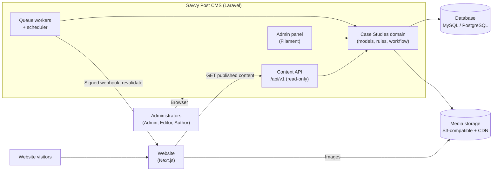
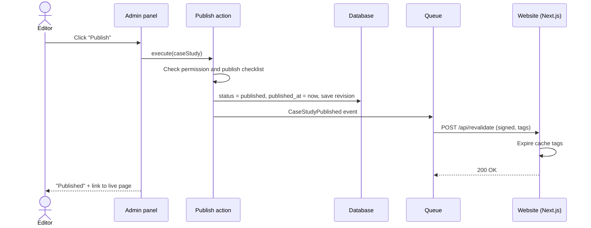
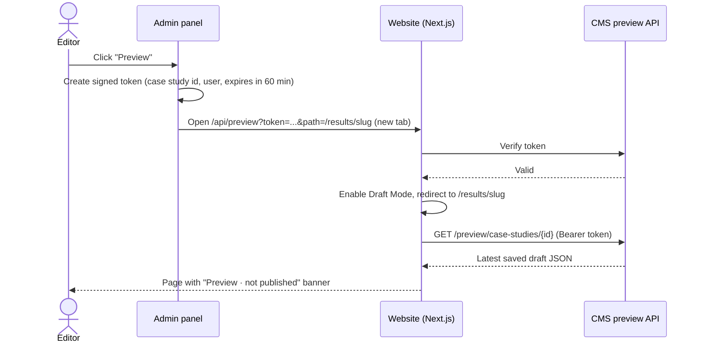

# 01 · Architecture

[← Index](README.md)

## System context



The CMS owns all content. The website never writes to the CMS; it reads
published content through the API and is told to refresh when content changes.

## Module structure inside the CMS

The module is self-contained so other modules (Blog, Industries, Resources) can
follow the same pattern.

```
app/
  Domain/CaseStudies/
    Models/          CaseStudy, CaseStudyMetric, CaseStudyChart, Client,
                     Testimonial, Industry*, Category*, GrowthPillar*
    Enums/           CaseStudyStatus, ChartType, MetricUnit, MetricDirection
    Actions/         Publish, Unpublish, Schedule, Archive, Restore,
                     Duplicate, SubmitForReview, RequestChanges
    Policies/        CaseStudyPolicy (one method per action)
    Events/          CaseStudyPublished, CaseStudyUnpublished, ...
    Listeners/       QueueWebsiteRevalidation, RecordRevision, NotifyReviewers
    Rules/           PublishReadiness (the publish checklist)
    Data/            ChartDataset (JSON schema + validation)
  Filament/Resources/CaseStudyResource/   list, create, edit, pages, actions
  Http/Controllers/Api/V1/                CaseStudyController, PreviewController
  Http/Resources/                         CaseStudyResource (API JSON shape)
```

`*` shared with other modules.

Rule of thumb: **screens never change status directly**. Every state change goes
through an Action class, which checks the policy, validates readiness, writes
the change, records a revision and fires an event. The same Actions back the
row actions, bulk actions and the scheduler, so behaviour is identical
everywhere.

## Technology decisions

### ADR-01 · Admin panel: Laravel + Filament (Proposed)

Filament gives most of what the screens need without custom UI work: resource
list pages with search, sorting, filters, pagination and bulk actions; forms with
tabs, sections, repeaters and a rich-text editor; action modals; notifications.
Its table filters can be kept in the user's session, and changes are applied
with an "Apply" button by default ([Filament filters docs](https://filamentphp.com/docs/4.x/tables/filters)).

| Option | Pros | Cons |
| --- | --- | --- |
| **Filament (recommended)** | Fastest to build; consistent admin UI; policies and actions built in | Admin look is Filament's; a pixel-exact chart preview needs a custom component |
| Laravel + Inertia + React | Full control of UI; can reuse the website's React chart component for an exact preview | Every list, form and modal is built by hand; 2–3× the admin effort |
| Off-the-shelf CMS on Laravel (Statamic) | Editors, revisions and roles ready-made | Content model and workflow follow the product's conventions; licensing for multi-user features |

Verify the current Filament major version before starting; examples in these
docs follow 4.x concepts.

### ADR-02 · Headless delivery (Proposed)

Next.js reads a **versioned, read-only JSON API** (`/api/v1`). Only published
content is exposed without a token. A separate preview endpoint returns drafts
and requires a signed, short-lived token.

### ADR-03 · Fixed sections as columns, repeatable items as tables (Proposed)

The case study layout is fixed (Challenge, Approach, Results, Lessons…), so each
section is a column on `case_studies`. Items that repeat or are reused
(metrics, charts, testimonials, gallery images) have their own tables. This keeps
queries simple, makes validation explicit and avoids a generic "blocks" JSON
blob that is hard to validate and migrate.

### ADR-04 · Chart data as validated JSON (Proposed)

A chart is small (≤ 12 categories × ≤ 3 series). Storing its dataset as one JSON
document per chart keeps editing simple (one table-like form) and makes the API
payload match what the chart component needs. The JSON is validated against a
schema on save (see [Data model § Chart dataset](03-data-model.md#chart-dataset-json)).
Normalized `series` / `points` tables were considered and rejected: more joins,
no reporting need across charts.

### ADR-05 · On-demand revalidation (Proposed)

Pages are cached on the website and refreshed only when content changes. When a
case study is published, updated while published, unpublished or archived, the
CMS sends a signed webhook to the website, which expires the affected cache tags.

In Next.js 16 `revalidateTag(tag, profile)` takes a second argument; `"max"` gives
stale-while-revalidate behaviour and the one-argument form is deprecated
([Next.js revalidateTag reference](https://unpkg.com/next@16.3.8/dist/docs/01-app/03-api-reference/04-functions/revalidateTag.md),
[Revalidating guide](https://nextjs.org/docs/app/getting-started/revalidating)).
Confirm the exact call for the Next.js version in use.

### ADR-06 · Preview via Draft Mode (Proposed)

The admin "Preview" button opens the real website page in Next.js Draft Mode,
so the editor sees the exact public design with unpublished content.

## Key flows

### Publishing and website refresh



Tags sent on each change:

| Change | Tags expired |
| --- | --- |
| Publish / update while published / unpublish / archive | `case-study:{id}`, `case-studies`, `industry:{industry_slug}` |
| Case study is featured or was featured | also `home` |
| Slug changed while published | also the old slug path; a 301 redirect is stored |
| Industry, client or testimonial edited | every case study tag that uses it |

If the webhook fails it is retried with backoff (3 attempts). After the last
failure the admin sees a warning on the case study ("Website may be out of
date · Retry") and the event is logged.

### Preview



Preview shows the **last saved** version. The editor shows a reminder when there
are unsaved changes.

### Scheduled publishing

A scheduler command runs every minute, finds case studies with
`status = scheduled` and `scheduled_at <= now`, and runs the same Publish action
as a human would (system user). Failures notify the author.

## Caching and performance

| Layer | Strategy |
| --- | --- |
| Website pages | Statically rendered, refreshed by tag (ADR-05) |
| Content API | Response cache per URL, cleared by the same events; `ETag` headers |
| Database | Indexes on `status`, `published_at`, `industry_id`, `client_id`, `slug` (see [Data model](03-data-model.md#indexes)) |
| Images | Stored once, resized variants generated on upload (cover: 1600w, 800w, 400w; WebP), served by CDN |
| Admin list | Server-side pagination; eager-load client, industry and author |

## Media handling

- Upload types: JPG, PNG, WebP, SVG (logos only). Max 10 MB.
- Cover image: minimum 1600 × 900 px, 16:9 crop tool in the editor.
- **Alt text is required** for cover, logo and gallery images before publishing.
- A media library package (for example Spatie Media Library) is **Proposed**; it
  is a new dependency and needs approval.

## Security

- Admin panel behind login; 2FA recommended for Admin role.
- Every action checks `CaseStudyPolicy` server-side; hiding a button is never the
  only protection.
- Public API exposes `published` records only and never returns internal fields
  (notes, reviewer comments, author email).
- Preview tokens: signed, single case study, 60-minute expiry.
- Revalidation webhook: shared secret + HMAC signature + timestamp (reject if older than 5 minutes).
- Rich text is sanitized on save (allow-list of tags) to prevent script injection.
- Rate limits on the public API.

## Observability

- Activity log of every create, update and status change (who, when, what changed).
- Failed webhooks and failed scheduled publishes are logged and shown on the
  module dashboard.
