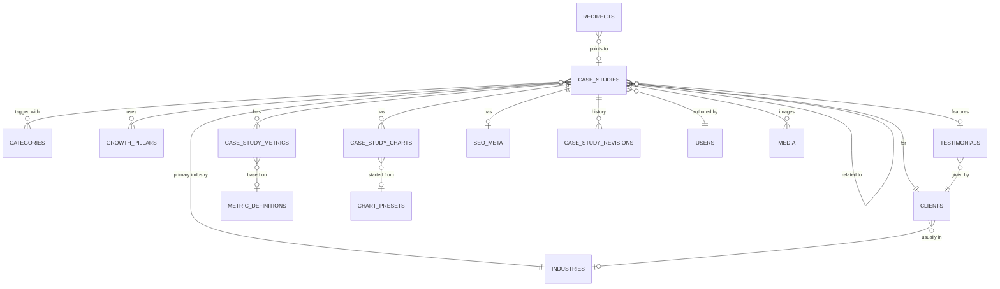

# 03 · Data model

[← Index](README.md)

Proposed schema for the Case Studies module. Names follow Laravel conventions
(plural snake_case tables, `id` bigint keys, `created_at` / `updated_at`
timestamps). **No migrations have been created.**

## Entity relationship diagram



## Storage approach

| Content | Stored as | Why |
| --- | --- | --- |
| Fixed sections (challenge, approach, results summary…) | Columns on `case_studies` | Layout is fixed; simple to validate and query |
| Metrics, charts | Child tables | Repeated, reordered, reported on, managed from their own screens |
| Testimonials, clients, industries, categories, pillars | Shared tables | Reused by other modules (Home, Industries, Growth System) |
| Small owned lists (pain points, timeline, lessons) | JSON columns | Never queried or reused; always edited with the parent |
| Chart dataset | JSON column, schema-validated | See ADR-04 |
| Rich text | HTML (sanitized) in `longText` | Rendered by the website with an allow-list |

## Tables

### `case_studies`

| Column | Type | Null | Notes |
| --- | --- | --- | --- |
| id | bigint PK | no | |
| uuid | uuid, unique | no | Used in preview URLs and the API for drafts |
| title | varchar(160) | no | |
| slug | varchar(160), unique | yes | Required to publish |
| client_id | FK → clients | yes | Required to publish; `restrict` on delete |
| show_client_name | boolean | no | Default from client |
| client_display_name | varchar(120) | yes | Used when `show_client_name = false` |
| industry_id | FK → industries | yes | Required to publish; `restrict` on delete |
| location_city | varchar(100) | yes | |
| location_region | varchar(100) | yes | State / province |
| location_country | char(2) | yes | ISO 3166-1, default `US` |
| engagement_start | date | yes | First day of month |
| engagement_end | date | yes | Null + `is_ongoing` = ongoing |
| is_ongoing | boolean | no | Default false |
| summary | varchar(300) | yes | |
| challenge_title | varchar(80) | yes | Null = "The challenge" |
| challenge_body | longText | yes | Sanitized HTML |
| pain_points | json | yes | `["Seasonal drop in calls", …]`, max 5 |
| approach_title | varchar(80) | yes | |
| approach_body | longText | yes | |
| timeline | json | yes | `[{phase, period, description}]`, max 6 |
| results_title | varchar(80) | yes | |
| results_body | longText | yes | |
| lessons_title | varchar(80) | yes | |
| lessons | json | yes | `[{headline, body}]`, max 5 |
| lessons_closing | longText | yes | |
| testimonial_id | FK → testimonials | yes | `set null` on delete |
| cta_type | enum | no | `explore_partnership` (default), `are_we_a_fit`, `custom` |
| cta_label | varchar(60) | yes | Custom only |
| cta_url | varchar(255) | yes | Custom only |
| status | enum | no | See [Status enum](#enums) |
| review_comment | text | yes | Last "request changes" comment |
| is_featured | boolean | no | Default false |
| display_order | int | yes | Manual ordering |
| author_id | FK → users | no | |
| last_edited_by | FK → users | yes | |
| published_by | FK → users | yes | |
| published_at | timestamp | yes | First publish; kept on re-publish |
| last_published_at | timestamp | yes | |
| scheduled_at | timestamp | yes | When status = scheduled |
| archived_at | timestamp | yes | |
| internal_notes | text | yes | Never exposed by the API |
| lock_version | int | no | Optimistic locking; +1 on every save |
| created_at / updated_at | timestamp | | |
| deleted_at | timestamp | yes | Soft delete (Trash) |

### `clients`

| Column | Type | Notes |
| --- | --- | --- |
| id | bigint PK | |
| name | varchar(120) | |
| slug | varchar(120), unique | |
| website_url | varchar(255) null | |
| industry_id | FK → industries null | Default for new case studies |
| location_city / location_region / location_country | | Defaults for new case studies |
| can_be_named | boolean | Default for `show_client_name` |
| notes | text null | Internal |
| timestamps, deleted_at | | |

Logo stored as media (collection `logo`).

### `industries` (shared)

`id, name, slug (unique), short_description, icon, is_active, sort_order, timestamps`

### `categories` (shared) and `case_study_category`

`categories`: `id, name, slug (unique), is_active, sort_order, timestamps`
`case_study_category`: `case_study_id, category_id` (composite PK)

### `growth_pillars` (shared) and `case_study_growth_pillar`

`growth_pillars`: `id, name, slug, short_description, sort_order, timestamps`
`case_study_growth_pillar`: `case_study_id, growth_pillar_id, notes (longText null), sort_order` (PK on the pair)

### `metric_definitions`

| Column | Type | Notes |
| --- | --- | --- |
| id | bigint PK | |
| label | varchar(80) | "Booked jobs per week" |
| unit | enum | `percent`, `currency`, `multiplier`, `number`, `custom` |
| custom_unit | varchar(20) null | "leads", "calls" |
| better_when | enum | `higher`, `lower` |
| decimals | tinyint | Default 0 |
| is_active | boolean | |
| timestamps | | |

### `case_study_metrics`

| Column | Type | Notes |
| --- | --- | --- |
| id | bigint PK | |
| case_study_id | FK → case_studies | `cascade` on delete |
| metric_definition_id | FK null | Null = custom metric |
| label | varchar(80) | Copied from definition, editable |
| value | decimal(14,4) | |
| unit | enum | As above |
| custom_unit | varchar(20) null | |
| direction | enum | `increase`, `decrease` |
| before_value | decimal(14,4) null | |
| comparison_label | varchar(120) null | "vs. same months of 2025" |
| source | varchar(120) null | "Measured in CRM" |
| is_highlighted | boolean | Max 3 per case study (Settings) |
| sort_order | int | |
| timestamps | | |

### `case_study_charts`

| Column | Type | Notes |
| --- | --- | --- |
| id | bigint PK | |
| case_study_id | FK → case_studies | `cascade` on delete |
| chart_preset_id | FK null | |
| title | varchar(120) | |
| type | enum | `paired_bar`, `bar`, `line`, `donut`, `big_number` |
| dataset | json | See [Chart dataset](#chart-dataset-json) |
| unit_label | varchar(40) null | "jobs per week" |
| x_caption | varchar(160) null | "Jan → Sep (each pair: 2025 left, 2026 right)" |
| source_note | varchar(160) null | Required to publish |
| text_summary | text null | Required to publish (accessibility) |
| show_trend_arrows | boolean | Default true for `paired_bar` |
| placement | enum | `after_results_summary` (default), `after_metrics`, `end_of_results` |
| sort_order | int | Max 4 per case study (Settings) |
| timestamps | | |

### `chart_presets`

`id, name, type, default_dataset (json, series only), default_x_caption, is_active, timestamps`

### `testimonials` (shared)

| Column | Type | Notes |
| --- | --- | --- |
| id | bigint PK | |
| client_id | FK → clients | |
| quote | varchar(400) | |
| person_name | varchar(100) | |
| person_role | varchar(100) null | |
| approved_by_client | boolean | Required true to publish with it |
| approved_at | date null | |
| is_active | boolean | |
| timestamps | | |

Photo stored as media (collection `photo`).

### `seo_meta` (polymorphic, shared)

`id, seoable_type, seoable_id, meta_title (varchar 70), meta_description (varchar 170), focus_keywords (json), canonical_url, noindex (bool), timestamps`
Unique on (`seoable_type`, `seoable_id`). Social image stored as media on the parent (collection `og_image`).

### `case_study_related`

`case_study_id, related_case_study_id, sort_order` — PK on the pair; a case study cannot relate to itself; max 3.

### `case_study_revisions`

| Column | Type | Notes |
| --- | --- | --- |
| id | bigint PK | |
| case_study_id | FK | |
| number | int | 1, 2, 3… per case study |
| snapshot | json | Full case study incl. metrics, charts, relations |
| status_from / status_to | enum null | When the revision is a status change |
| summary | varchar(200) | "Updated 3 metrics", "Published" |
| created_by | FK → users | |
| created_at | timestamp | |

A revision is written on every manual save and every status change. Keep all
revisions for published case studies; for drafts keep the last 50.

### `redirects` (shared)

`id, from_path (unique), to_path, status_code (301), redirectable_type/id (null), hits, timestamps`
Created automatically when a published slug changes; exposed to the website.

### `media` (shared, Proposed package)

Polymorphic media table with collections: `cover`, `logo`, `photo`, `og_image`,
`gallery`. Each item stores `alt_text` (required on publish) and generated
size variants.

### Users, roles, activity log

Reuse the CMS-wide `users` table, a roles/permissions package (Proposed) and an
activity log table (`subject`, `causer`, `event`, `properties`, `created_at`).

## Enums

**CaseStudyStatus:** `draft`, `in_review`, `changes_requested`, `scheduled`, `published`, `archived`.
(Deleted = soft-deleted row, not a status.)

**ChartType:** `paired_bar`, `bar`, `line`, `donut`, `big_number`.

**MetricUnit:** `percent`, `currency`, `multiplier`, `number`, `custom`.

**MetricDirection:** `increase`, `decrease`.

**CtaType:** `explore_partnership`, `are_we_a_fit`, `custom`.

## Chart dataset (JSON)

```json
{
  "categories": ["Jan", "Feb", "Mar", "Apr", "May", "Jun", "Jul", "Aug", "Sep"],
  "series": [
    { "key": "2025", "name": "2025", "role": "baseline",
      "values": [9, 9, 8, 9, 10, 11, 13, 14, 10] },
    { "key": "2026", "name": "2026 (with Savvy)", "role": "savvy",
      "values": [10, 10, 11, 12, 13, 14, 16, 17, 15] }
  ]
}
```

Rules (checked on save):

| Rule | Limit |
| --- | --- |
| `categories` | 2–12 strings, each ≤ 20 chars, unique |
| `series` | 1–3 items; `paired_bar` exactly 2 (one `baseline`, one `savvy`); `donut` exactly 1; `big_number` exactly 1 with 1 value |
| `role` | `baseline`, `savvy`, `other` — decides color on the website |
| `values` | Numbers only, same length as `categories`, no nulls |
| `donut` values | ≥ 0, max 6 categories |

## Indexes

| Table | Index | Used by |
| --- | --- | --- |
| case_studies | unique(`slug`) | API lookup, uniqueness |
| case_studies | (`status`, `published_at`) | Public list, dashboard |
| case_studies | (`industry_id`, `status`) | Industry filter on site and admin |
| case_studies | (`client_id`) | Client filter |
| case_studies | (`author_id`) | Author filter, "my drafts" |
| case_studies | (`status`, `scheduled_at`) | Scheduler |
| case_studies | (`is_featured`, `status`) | Home page |
| case_studies | (`updated_at`) | Default admin sort |
| case_study_metrics / charts | (`case_study_id`, `sort_order`) | Ordered loading |

Admin search at launch uses `LIKE` on title, client name, industry name, summary
and focus keywords. Add a full-text index if the list grows past a few thousand rows.

## Validation summary

Two levels:

1. **Save (draft):** types, lengths, formats, uniqueness, chart dataset schema. Never blocks on missing content.
2. **Publish readiness:** the checklist in [Admin screens § Readiness checklist](02-admin-screens.md#right-sidebar). Implemented once (a `PublishReadiness` rule) and used by the editor, bulk publish, the scheduler and the review queue.

## Localization

Launch is English only. If translations are added later, text columns move to a
`case_study_translations` table (`case_study_id`, `locale`, translatable
columns) and the API takes `?locale=`. Numbers and chart values stay on the
parent. No change needed now beyond keeping all user-facing text in the listed
columns.
