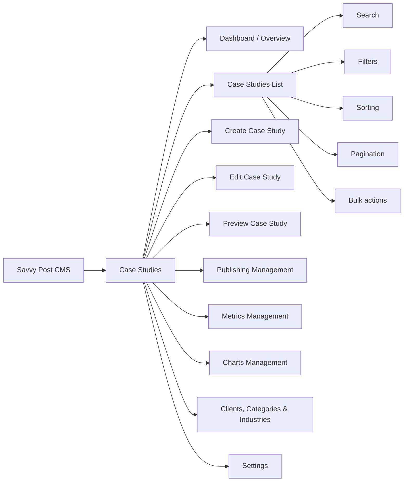

# Case Studies Module — Savvy Post CMS

Architecture, administrative workflows and data structure for the Case Studies
module of the Savvy Post CMS. This is a **documentation-only** deliverable: no
application code, migrations or dependencies were added. Anything marked
**Proposed** needs approval before implementation.

| Doc | What it covers |
| --- | --- |
| [01 · Architecture](01-architecture.md) | System context, module map, technology decisions, preview and publishing flows, caching, media, security |
| [02 · Admin screens](02-admin-screens.md) | Every administrative screen: dashboard, list, editor (all tabs), preview, publishing, metrics, charts, taxonomies, settings |
| [03 · Data model](03-data-model.md) | ERD, tables, columns, enums, JSON schemas, indexes, validation rules |
| FigJam board | Diagrams, wireframes, list behavior, editor field specs, role permissions and publishing rules |

Workflow/permission details, the API contract and website mapping are not
written up here yet; the FigJam board is the working source for those.

Wireframes and diagrams live in the FigJam board
[Savvy Websites · CMS](https://www.figma.com/board/HmT2D5wIvhGm7e74AogefM/Savvy-Websites---cms).

## Scope

In scope: everything an administrator needs to create, edit, review, preview,
publish, organize and retire case studies, plus the contract the Next.js
website uses to display them.

Out of scope: the visual design of the public pages, the other CMS modules
(Blog, Industries pages, Careers…) beyond the shared pieces they reuse
(taxonomies, media, SEO, roles), analytics dashboards, and data migration from
the current site.

## Module map

## Assumptions

These come from the project brief and earlier conversations. Each one should be
confirmed; the docs say where a different answer would change the design.

1. **Public website:** Next.js (App Router), fetching content from the CMS over HTTP.
2. **CMS:** a Laravel application. The admin panel is built with Filament
   (Proposed, see ADR-01 in [Architecture](01-architecture.md#technology-decisions)).
3. **No page builder.** Case studies use a fixed, structured form. Free-form
   content is limited to rich-text fields inside each section.
4. **One language (English) at launch.** The data model leaves room for
   translations (see [Data model § Localization](03-data-model.md#localization)).
5. **Industries are shared** with the website's Industries section. One list
   feeds both.
6. **Charts are structured data**, not images. The website draws them in the
   brand style (paired bars "2025 vs 2026 (with Savvy)", source line, legend).
7. **Review before publishing** is on by default and can be turned off in Settings.

## Open questions

| # | Question | Why it matters | Default used in these docs |
| --- | --- | --- | --- |
| Q1 | Is Laravel + Filament approved for the CMS, or should the admin be built with Laravel + Inertia (React)? | Decides how much of the admin UI comes ready-made | Filament |
| Q2 | Can a case study be published without naming the client (anonymous, "a home services company in Texas")? | Adds a display-name override and hides the logo | Yes, supported |
| Q3 | Does a case study belong to one industry or several? | One-to-many vs many-to-many | One primary industry + optional extra tags |
| Q4 | Who approves? A named reviewer per case study, or anyone with the Editor role? | Affects notifications and the review queue | Anyone with publish permission |
| Q5 | Do we need scheduled publishing at launch? | Needs a scheduler running on the server | Included |
| Q6 | Must deleted case studies be recoverable? | Soft delete + trash screen | Soft delete, purge after 30 days |
| Q7 | URL prefix for case studies on the website: `/results/…` or `/case-studies/…`? | Slugs, redirects, sitemap | `/results/{slug}` |
| Q8 | Where do client testimonials live: only inside case studies, or a shared library also used on Home? | Separate table vs embedded fields | Shared library (reusable) |

## Decision log

| ID | Decision | Status |
| --- | --- | --- |
| ADR-01 | Laravel + Filament for the admin panel | Proposed |
| ADR-02 | Headless: Next.js reads a versioned, read-only JSON API | Proposed |
| ADR-03 | Fixed sections stored as columns; repeatable items (metrics, charts, testimonials) in their own tables | Proposed |
| ADR-04 | Chart data stored as validated JSON per chart | Proposed |
| ADR-05 | On-demand revalidation of Next.js pages via signed webhook on publish | Proposed |
| ADR-06 | Draft preview through Next.js Draft Mode with a short-lived signed token | Proposed |

Details and alternatives are in [Architecture § Technology decisions](01-architecture.md#technology-decisions).
