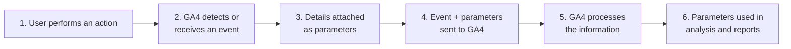
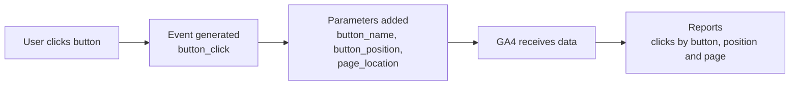

# GA4 Event Parameters — Research Notes

> **Status: research only.** Nothing described here is implemented in this project.
> GA4 and GTM were not installed, no external account or custom dimension was configured,
> and no API keys, environment variables or deployments were changed.
> The code below is an illustrative example, not code that runs on this site.
>
> **Reading time:** 5–10 minutes · **Primary sources:** official Google Analytics documentation (links at the end) · **Last reviewed:** November 2026 · **Related:** [GA4 Event Tracking](./GA4_EVENT_TRACKING.md)

---

## 1. Overview

In GA4, every visitor action is recorded as an **event**, such as a page view, a click or a form submission. An event name alone only says *what* happened. **Event parameters** add the details: *which* button, *on which* page, *where* on the page.

This document explains:

- what event parameters are and which types exist,
- how they travel with an event to GA4,
- how developers send them,
- why collecting a parameter is not the same as seeing it in reports,
- best practices for clean, privacy-safe data.

---

## 2. What Are Event Parameters?

An **event parameter** is a piece of extra information attached to an event as a **name: value** pair.

- The **event name** says *what happened*: `button_click`.
- The **parameters** describe *the details* of that action.

**Example**

**Event:** `button_click`

**Parameters:**
- `button_name`: Contact Us. *Which* button was clicked, using the label the visitor saw.
- `page_location`: https://example.com/contact. *Which page* the visitor was on, as the full URL.
- `button_position`: header. *Where* on the page the button sits.

Without parameters you would only know "a button was clicked 500 times". With parameters you can see "the **Contact Us** button in the **header** of the **contact page** was clicked 120 times".

**Why parameters are useful**

- They let one event cover many situations. A single `button_click` event can track every button, with no need for a separate event per button.
- They answer questions like *which* option, *where* and *how*, so you can compare buttons, pages or placements.
- They keep the list of event names short and tidy.

---

## 3. Types of Parameters

**1. Automatically collected parameters**
Sent by the Google tag with **every** web event, including custom ones. No setup needed.
*Examples:* `page_location` (full page URL), `page_title` (page title). Also `page_referrer`, `language` and `screen_resolution`.

**2. Recommended parameters**
Defined by Google for its **recommended events**. You send them yourself, using Google's exact names.
*Examples:* `method` on `login` or `sign_up` (how the user signed in, e.g. "Google"). `lead_source` on `generate_lead`.

Enhanced measurement events also come with their own predefined parameters. For example, outbound `click` events include `link_url`, and `form_start` / `form_submit` include `form_id`.

**3. Custom parameters**
Names you create for details that GA4 doesn't define.
*Examples:* `button_name`, `button_position`.

> **Not every parameter exists on every event.** Each event has its own set of parameters. `link_url` comes with link clicks, `form_id` comes with form events, and `method` only appears if your site sends it. What you actually receive depends on the event and on how tracking is configured.

---

## 4. How Event Parameters Work

1. **A user performs an action** on the website, such as clicking a button.
2. **GA4 detects or receives an event.** It is detected automatically through enhanced measurement, or sent by the site's code or GTM.
3. **Details are attached as parameters.** Automatic ones (page URL, title) plus any recommended or custom ones.
4. **The event and its parameters are sent to GA4** in one request from the browser.
5. **GA4 processes the information.** It checks limits and adds session, device and location data.
6. **The parameters can be used** for analysis and reporting, in DebugView, explorations and reports (some need a custom dimension, see section 7).



---

## 5. Common Parameter Examples

| Parameter | Type | Example value | Purpose | Comes with |
|---|---|---|---|---|
| `page_location` | Standard (automatic) | `https://example.com/contact` | Identifies the page URL (the full URL, not just `/contact`) | Every web event |
| `page_title` | Standard (automatic) | `Contact Us` | Identifies the page title | Every web event |
| `link_url` | Standard (enhanced measurement) | `https://partner-site.com` | Identifies the clicked link | Outbound `click` and `file_download` events |
| `form_id` | Standard (enhanced measurement) | `contact_form` | Identifies a form (from its HTML `id`) | `form_start` and `form_submit` events |
| `method` | Standard (recommended) | `email` | Describes the interaction method | `login`, `sign_up` and `share`, only if the site sends it |
| `button_name` | **Custom** (example only) | `Get Started` | Identifies a custom button | Only events your site sends it with |

**Notes**

- `button_name` is **not** a GA4 parameter. It is a name a team would choose. GA4 only knows it if your site sends it.
- **Limits** (standard GA4 properties): up to **25 parameters per event**, parameter names up to **40 characters**, values up to **100 characters**. `page_location` is the exception, with values up to 1,000 characters.

---

## 6. Basic Implementation

Parameters are sent together with the event. There are three common ways to do it:

- **Google tag (`gtag.js`):** the site's code calls `gtag('event', name, { parameters })`. Automatic parameters such as `page_location` are added for you.
- **Google Tag Manager (GTM):** in a **GA4 Event** tag, you set the event name and add rows of *parameter name → value*. Values usually come from GTM variables.
- **`dataLayer`:** a list on the page that GTM reads. The site *pushes* the event and its details, for example `dataLayer.push({ event: 'button_click', button_name: 'Contact Us' })`, and GTM maps those values to GA4 parameters.

### Example: custom event with parameters (illustrative only)

```js
// Assumes the Google tag (gtag.js) is already on the page.
gtag('event', 'button_click', {
  button_name: 'Contact Us',   // which button
  button_position: 'header',   // where on the page
  page_type: 'services'        // what kind of page
});
```

**In plain English:** "Tell GA4 that a **button_click** happened. The button was **Contact Us**, it was in the **header**, and the visitor was on a **services** page." GA4 also adds `page_location` and `page_title` automatically, so they don't need to be written here.

> Use **one** method per event (Google tag *or* GTM). Sending the same event both ways creates duplicates.

---

## 7. Parameters in GA4 Reports

**How parameters help:** they let you break an event down. Instead of "`button_click`: 500", you can see the count per button name, per position or per page.

**Collected ≠ available in reports**

- **Collecting** a parameter means GA4 *receives* it with the event. You can see it right away in **DebugView** when testing.
- **Making it available in reports** means *registering* it. For most custom parameters you create a **custom dimension** (*Admin → Custom definitions → Create custom dimension*, scope: **Event**, then enter the parameter name, e.g. `button_name`).
- Many standard parameters, such as `page_location` and `page_title`, already have built-in dimensions ("Page location", "Page title"). Custom parameters such as `button_name` don't, until you register them.
- Standard properties allow up to **50 event-scoped custom dimensions**, so register only the parameters you will really analyze.

**Why some values don't appear immediately**

- A new custom dimension can take **24–48 hours** to show data in reports.
- Reports fill in from data collected **after** the dimension is set up, so register a parameter as soon as you start sending it.
- Standard reports in general take 24–48 hours to finish processing.
- A value can show as **"(not set)"** when the event didn't include that parameter, for example a different event or an older event.

---

## 8. Practical Example: Several Contact Buttons

A website has three "Contact" buttons: in the **header**, in the **hero** section and in the **footer**. Instead of creating three events, every button sends the same event, `button_click`, with different parameters:

- **Which button was clicked?** → `button_name` (custom): "Contact Us", "Book a call", "Get in touch".
- **Which page was the user on?** → `page_location` (automatic): `https://example.com/services`.
- **Where was the button?** → `button_position` (custom): `header`, `hero` or `footer`.

After registering `button_name` and `button_position` as custom dimensions, a report can answer questions like *"On the services page, do more people click the hero button or the header button?"*



> Clicking a "Contact" button shows **interest**, not a lead. A confirmed lead should be measured separately, e.g. with `generate_lead` after a form succeeds. See [GA4 Event Tracking](./GA4_EVENT_TRACKING.md#8-practical-example-contact-form).

---

## 9. Best Practices

- **Use clear and consistent parameter names.** Use lowercase `snake_case` and the same name everywhere (`button_name`, not `buttonName` in one place and `btn_name` in another). Names are case-sensitive. Use Google's names when a standard parameter exists, and don't use reserved prefixes such as `ga_`, `google_` or `firebase_`.
- **Avoid sending personal information.** Never put names, email addresses, phone numbers or similar data in parameter values, URLs or page titles. Google's policies forbid it. Send neutral labels like `form_id: contact_form`, never what the visitor typed.
- **Don't create unnecessary parameters.** Every parameter should answer a real question. Custom dimension slots are limited, and too many parameters make data harder to read.
- **Avoid duplicate events.** Send each event from one place only (Google tag *or* GTM), and don't fire it again on re-renders. Duplicates double-count every parameter value too.
- **Verify that parameters are collected correctly.** Use **Tag Assistant** and GA4 **DebugView** to check each event: right names, expected values, nothing missing, nothing extra. Check again after any site change.
- **Respect user consent and privacy requirements.** Where required (e.g. EU/UK), use a consent banner and **Google Consent Mode**, and make tracking follow the visitor's choice.

---

## 10. Key Takeaways

1. An **event name** says *what* happened. **Parameters** say *which, where and how*.
2. Parameters come in three types: **automatic** (`page_location`, `page_title`), **recommended** (e.g. `method`), and **custom** (e.g. `button_name`).
3. **Not every parameter is on every event.** It depends on the event and the configuration.
4. Parameters are sent with the event through the **Google tag**, **GTM** or the **`dataLayer`**.
5. **Collecting ≠ reporting.** Custom parameters need a **custom dimension** to appear in standard reports, which can take **24–48 hours**.
6. Keep names **consistent**, send **no personal data**, add only **useful** parameters, avoid **duplicates**, **verify** in DebugView and respect **consent**.

---

## Official Sources

**Google Analytics Help**

- [Analytics event parameters](https://support.google.com/analytics/table/13594742)
- [Automatically collected events](https://support.google.com/analytics/answer/9234069)
- [Enhanced measurement events](https://support.google.com/analytics/answer/9216061)
- [Recommended events](https://support.google.com/analytics/answer/9267735)
- [Event collection limits](https://support.google.com/analytics/answer/9267744)
- [Event naming rules](https://support.google.com/analytics/answer/13316687)
- [About custom dimensions and metrics](https://support.google.com/analytics/answer/14240153)
- [Create event-scoped custom dimensions](https://support.google.com/analytics/answer/14239696)
- [Configuration limits](https://support.google.com/analytics/answer/12229528)
- [Monitor events in DebugView](https://support.google.com/analytics/answer/7201382)
- [Best practices to avoid sending personally identifiable information](https://support.google.com/analytics/answer/6366371)

**Google for Developers**

- [Set up event parameters](https://developers.google.com/analytics/devguides/collection/ga4/event-parameters)
- [Recommended events reference](https://developers.google.com/analytics/devguides/collection/ga4/reference/events)
- [Set up events](https://developers.google.com/analytics/devguides/collection/ga4/events)
- [The data layer](https://developers.google.com/tag-platform/tag-manager/datalayer)
- [Consent mode](https://developers.google.com/tag-platform/security/guides/consent)

**Tag Manager Help**

- [Set up Google Analytics events in Tag Manager](https://support.google.com/tagmanager/answer/13034206)

> **Research note:** Google's documentation sites could not be opened directly from this research environment because of network restrictions. The facts above were checked against Google's search index of these official pages in November 2026. GA4 menus and limits change over time, so confirm details on the linked pages before acting on them.
