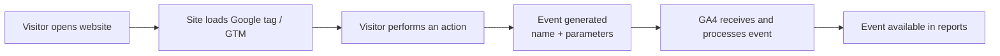
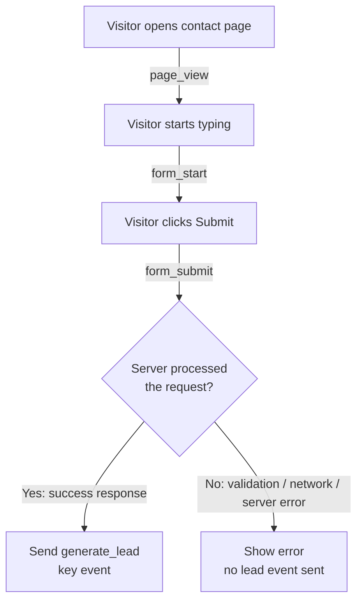

# GA4 Event Tracking — Research Notes

> **Status: research only.** Nothing in this document is implemented in this project.
> No GA4 property, Measurement ID, tag, `dataLayer` push or environment variable was created or changed.
> Code snippets are illustrative examples, not code that runs on this site.
>
> Reading time: about 5–10 minutes. Sources: official Google Analytics and Google Tag Manager documentation (listed at the end).

---

## 1. Introduction

**Google Analytics 4 (GA4)** is Google's analytics platform for websites and apps. Unlike older versions of Google Analytics, GA4 is **event-based**: every interaction, including a page view, is recorded as an *event*.

This document explains, from a developer's perspective:

- what an event is and what types exist,
- how an event travels from the browser to GA4,
- how events are sent (Google tag vs. Google Tag Manager),
- how to test them before publishing,
- and what privacy rules to keep in mind.

---

## 2. What Is Event Tracking?

An **event** is a single user interaction or system occurrence, recorded with a **name** and optional **parameters** (extra details).

```text
event name:  form_submit
parameters:  form_id = "contact", page_location = "https://example.com/contact"
```

**Why websites track events**

- To know *what people do*, not just which pages they visit (clicks, scrolls, form use, downloads).
- To find friction (e.g., many people start a form but few finish it).
- To measure whether the website meets its business goals (leads, sign-ups, purchases).

**Events vs. key events**

| | Event | Key event |
|---|---|---|
| What it is | Any tracked interaction | An event *you mark* as important to the business |
| Example | `scroll`, `click`, `form_start` | `generate_lead`, `purchase`, `sign_up` |
| How it's created | Collected or sent by the site | An existing event toggled as "key event" in GA4 Admin |

> GA4 previously called key events **"conversions."** Google renamed them; in Google Ads, "conversions" still exist and can be created *from* GA4 key events.

---

## 3. Types of GA4 Events

| Category | Who defines it | Setup needed | Example |
|---|---|---|---|
| **1. Automatically collected** | Google | None — sent by the Google tag | `first_visit`, `session_start`, `user_engagement` |
| **2. Enhanced measurement** | Google | Toggle on/off in the web data stream settings | `scroll` (user reaches ~90% of the page) |
| **3. Recommended** | Google defines name + parameters; *you* send it | Code or GTM | `generate_lead`, `sign_up`, `login` |
| **4. Custom** | You | Code or GTM | `pricing_toggle_click` |

**Rule of thumb:** before inventing a custom event, check whether a **recommended** event already fits. Recommended events unlock prebuilt reports (for example, the Lead acquisition report uses `generate_lead`).

---

## 4. Common Event Examples

| Event | User Action | Purpose | Category |
|---|---|---|---|
| `page_view` | Opens a page | Measure page visits | Enhanced measurement |
| `scroll` | Scrolls to the bottom (~90%) of a page | Measure engagement | Enhanced measurement |
| `click` | Clicks a link to an external domain | Track outbound navigation | Enhanced measurement |
| `form_start` | Interacts with a form for the first time in a session | Measure form engagement | Enhanced measurement |
| `form_submit` | Submits a form | Track form submissions | Enhanced measurement |
| `generate_lead` | Completes a lead action (e.g., request confirmed) | Measure lead generation | Recommended |

**Important notes**

- **Availability depends on configuration.** Enhanced measurement events only appear if they are enabled in the data stream. Recommended and custom events only exist if the site sends them.
- **`form_submit` ≠ a lead.** It means the browser submitted the form. It does **not** prove the server accepted it, that validation passed, or that the lead reached the CRM or inbox. Automatic form detection can also miss forms built with custom JavaScript.
- Event *parameters* (e.g., `form_id`) only appear in standard reports after you register them as **custom dimensions**.

---

## 5. How Event Tracking Works

1. A visitor opens a website.
2. The website loads the tracking configuration (the Google tag, directly or via GTM).
3. The visitor performs an action (scroll, click, submit).
4. An event is generated with a name and parameters.
5. The browser sends it to GA4, which receives and processes it.
6. The event becomes available for analysis (Realtime within seconds; standard reports can take 24–48 hours).



---

## 6. Basic Implementation

### Key concepts

| Term | What it is |
|---|---|
| **GA4 Measurement ID** | The ID of a web data stream, format `G-XXXXXXXXXX`. Tells the tag *where* to send data. |
| **Google tag (`gtag.js`)** | A JavaScript library added to the page. Sends page views and enhanced measurement events automatically, and custom events via `gtag('event', ...)`. |
| **Google Tag Manager (GTM)** | A tag management tool. You install one container snippet; tags, triggers and variables are then configured in the GTM web interface. |
| **`dataLayer`** | A JavaScript array on the page used to pass information to GTM (or gtag). The site *pushes* data into it; GTM *reads* it. |
| **Event name** | Identifies the action, e.g. `generate_lead`. Use `snake_case`, start with a letter, keep it short (max 40 characters), and don't use reserved names or prefixes (`ga_`, `google_`, `firebase_`). |
| **Event parameters** | Key/value details about the event, e.g. `form_id: "contact"`. |

### Example: a custom event (illustrative only)

Sending directly with the Google tag:

```js
// Assumes gtag.js is already loaded with a Measurement ID.
gtag('event', 'pricing_toggle_click', {
  plan_period: 'annual',   // parameter: which option the user picked
  page_section: 'pricing'  // parameter: where it happened
});
```

The same idea when using GTM — the site only pushes data; GTM decides what to send:

```js
window.dataLayer = window.dataLayer || [];
window.dataLayer.push({
  event: 'pricing_toggle_click',
  plan_period: 'annual'
});
```

### Google tag vs. Google Tag Manager

| | Google tag (`gtag.js`) directly | Google Tag Manager |
|---|---|---|
| Where events are defined | In the site's source code | In the GTM interface (triggers + tags) |
| Changing tracking | Requires a code change and deploy | Often no deploy; publish a new GTM version |
| Best for | Simple sites, few events, developer-owned tracking | Multiple tags/vendors, marketing-owned changes, versioning and preview |
| Typical pattern | `gtag('event', ...)` | Code does `dataLayer.push(...)`, GTM fires a **GA4 Event** tag |

Pick **one** approach per event. Sending the same event from both causes duplicates.

---

## 7. Testing Events

| Tool | What it shows | When to use it |
|---|---|---|
| **Google Tag Assistant** ([tagassistant.google.com](https://tagassistant.google.com/)) | Which tags load on a page and what each sends | Quick check that the tag is installed and firing |
| **GTM Preview mode** | Each trigger, tag and `dataLayer` push as you click through the site | Testing GTM changes *before* publishing the container |
| **GA4 DebugView** (Admin → DebugView) | Events from debug-enabled devices in near real time, with parameters | Confirming GA4 actually received the event with the right name and parameters |
| **Browser developer tools** | Network tab: requests to `google-analytics.com/g/collect` (`en=` is the event name). Console: inspect `window.dataLayer` | Low-level check; useful when other tools are blocked |

**Why test before publishing**

- Bad data can't be fixed retroactively — GA4 does not rewrite past events.
- Typos in event names create new, separate events (`generate_lead` vs. `generateLead`).
- Duplicates or missing events distort key event counts and ad optimization.
- Testing catches accidental personal data in parameters before it is collected.

---

## 8. Practical Example: Contact Form

Goal: understand the journey from visiting the contact page to a confirmed lead.

| Step | Event | How it's typically captured | What it proves |
|---|---|---|---|
| Visitor opens `/contact` | `page_view` | Automatic (enhanced measurement) | The page was viewed |
| Visitor types in the first field | `form_start` | Enhanced measurement, or custom trigger | Interest / engagement |
| Visitor clicks **Submit** | `form_submit` | Enhanced measurement, or custom trigger | The browser *attempted* to submit |
| Server confirms the request | `generate_lead` | Sent by the site **only after a success response** (or on a thank-you page) | The lead was actually accepted |

**Submit click vs. confirmed success**

- Clicking Submit can still fail: validation errors, spam protection, network errors or a server error.
- The reliable signal is to send `generate_lead` **after** the form handler returns success (e.g., HTTP 200 from the API) or when the confirmation page loads.
- Mark **`generate_lead`** — not `form_submit` — as the key event.



Illustrative success handler (not implemented in this project):

```js
const response = await fetch('/api/contact', { method: 'POST', body: formData });
if (response.ok) {
  gtag('event', 'generate_lead', { form_id: 'contact' }); // no name, email or phone
}
```

---

## 9. Privacy Considerations

- **Consent where required.** In regions such as the EEA/UK, analytics cookies may require prior consent. Use a consent banner (CMP) and **Google Consent Mode** so tags respect the visitor's choice.
- **Respect preferences.** If a visitor declines or withdraws consent, tags must follow that state. Don't fire GA4 tags in a way that bypasses the consent configuration.
- **No personally identifiable information (PII).** Google's policies forbid sending names, emails, phone numbers or addresses to GA4 — in event parameters, URLs or page titles. Send IDs or categories (`form_id: "contact"`), never form field values.
- **Avoid duplicate events.** Don't send the same event from both `gtag.js` and GTM, don't fire it on every re-render, and don't count both enhanced `form_submit` and a custom submit for the same action.
- Review the site's **privacy policy** whenever tracking changes.

---

## 10. Key Takeaways

1. GA4 is **event-based**: every interaction is an event with a name and parameters.
2. There are four event types: **automatic, enhanced measurement, recommended, custom**. Prefer recommended names before inventing custom ones.
3. A **key event** is just an event marked as important; it was formerly called a conversion.
4. Implement with the **Google tag** (simple, code-based) or **GTM** (`dataLayer` + tags in a UI) — not both for the same event.
5. **`form_submit` is not a lead.** Send `generate_lead` only after confirmed success.
6. Always **test** with Tag Assistant, GTM Preview and DebugView before publishing.
7. Respect **consent**, never send **PII**, and prevent **duplicates**.

---

## Official Sources

**Google Analytics**

- [Enhanced measurement events](https://support.google.com/analytics/answer/9216061)
- [Automatically collected events](https://support.google.com/analytics/answer/9234069)
- [Recommended events (Help Center)](https://support.google.com/analytics/answer/9267735)
- [Recommended events reference (Developers)](https://developers.google.com/analytics/devguides/collection/ga4/reference/events)
- [Set up events (Developers)](https://developers.google.com/analytics/devguides/collection/ga4/events)
- [Conversions vs. key events](https://support.google.com/analytics/answer/13965727)
- [Tutorial: Set up a key event](https://support.google.com/analytics/answer/12966437)
- [How to report on your lead generation form](https://support.google.com/analytics/answer/12944921)
- [Analytics event parameters](https://support.google.com/analytics/table/13594742)
- [Monitor events in DebugView](https://support.google.com/analytics/answer/7201382)
- [Best practices to avoid sending PII](https://support.google.com/analytics/answer/6366371)

**Google Tag Manager / Google tag**

- [The data layer](https://developers.google.com/tag-platform/tag-manager/datalayer)
- [Google tag (gtag.js)](https://developers.google.com/tag-platform/gtagjs)
- [Preview and debug containers](https://support.google.com/tagmanager/answer/6107056)
- [Tag Assistant](https://support.google.com/tagassistant/answer/10039345)
- [Consent mode](https://developers.google.com/tag-platform/security/guides/consent)

> Research note: Google Help Center pages could not be opened directly from this research environment (network restrictions); content was confirmed via Google's search index of these official pages. Verify links and current UI labels before use, as Google updates GA4 frequently.
