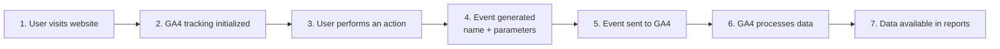
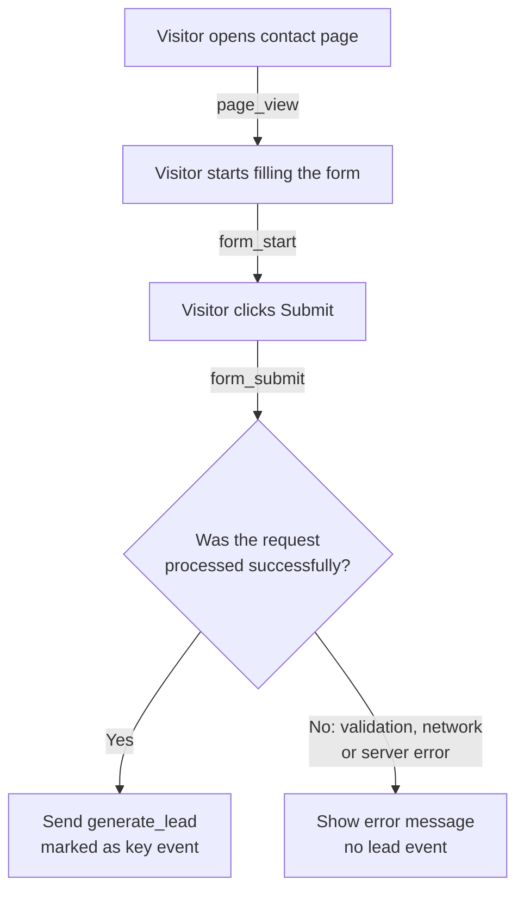

# GA4 Event Tracking — Research Notes

> **Status: research only.** Nothing described here is implemented in this project.
> No tracking script was installed, no GA4 property or external account was configured,
> and no API keys, environment variables or deployments were changed.
> The code below is an illustrative example, not code that runs on this site.
>
> **Reading time:** 5–10 minutes · **Primary sources:** official Google Analytics and Tag Manager documentation (links at the end) · **Last reviewed:** November 2026

---

## 1. Overview

**Google Analytics 4 (GA4)** is Google's free tool for measuring how people use a website or app. GA4 records almost everything as an **event**, including a simple page visit.

This document explains, in plain terms:

- what an event is and which types exist,
- how an event travels from the visitor's browser to GA4 reports,
- how developers send events and check that they work,
- what to be careful about (duplicates, privacy, delays).

---

## 2. What Is Event Tracking?

An **event** is one thing a visitor did, saved with:

- a **name**, such as `form_submit`, and
- optional **parameters**: extra details, such as `form_id: "contact"`.

**Event tracking** means recording these actions so you can count and analyze them.

**Why websites use it**

- To see what visitors *do*, not just which pages they open.
- To find problems. For example, many people start a form but few finish it.
- To measure goals such as leads, sign-ups or purchases.

**What can be measured.** Some examples:

- Visiting a page and scrolling down it
- Clicking a button, or a link to another website
- Starting and submitting a form
- Downloading a file or watching an embedded video

**Events vs. key events.** Any action can be an event. A **key event** is an event that *you mark* in GA4 as important to the business, for example `generate_lead`. Key events were previously called "conversions" in GA4.

---

## 3. Types of GA4 Events

GA4 events come in four categories:

**1. Automatically collected events**
Sent by the Google tag as soon as it is installed. No extra setup.
*Example:* `session_start`, recorded when a visit begins.

**2. Enhanced measurement events**
Also automatic, but each one can be switched on or off in GA4's web data stream settings.
*Example:* `scroll`, recorded the first time a visitor reaches the bottom (about 90%) of a page.

**3. Recommended events**
Google defines the name and parameters. Your website has to send them.
*Example:* `generate_lead` when someone completes a lead form.

**4. Custom events**
Names and parameters you create yourself, for actions that no other category covers.
*Example:* `pricing_toggle_click` when a visitor switches between monthly and annual prices.

> **Tip:** check whether a **recommended** event fits before creating a custom one. Recommended events work with GA4's built-in reports.

---

## 4. How Event Tracking Works

1. **A user visits a website.**
2. **GA4 tracking is initialized:** the page loads the Google tag, directly or through Google Tag Manager.
3. **The user performs an action:** a click, a scroll or a form submission.
4. **An event is generated** with a name and parameters.
5. **The event is sent to GA4** by the browser.
6. **GA4 processes the information:** it validates the event and adds session, device and location data.
7. **The data becomes available in reports.** Realtime and DebugView show it quickly; standard reports take longer.



---

## 5. Common Event Examples

| Event | User Action | Purpose |
|---|---|---|
| `page_view` | Opens a page | Track page visits |
| `scroll` | Scrolls through a page (reaches ~90%) | Measure engagement |
| `click` | Clicks an outbound link (to another domain) | Track external navigation |
| `form_start` | Starts filling out a form | Track form interactions |
| `form_submit` | Submits a form | Measure submissions |
| `generate_lead` | Completes a lead action | Track lead generation |

**Good to know**

- **Some events need configuration.** `page_view`, `scroll`, `click`, `form_start` and `form_submit` come from enhanced measurement and only appear if those options are on in the data stream. `generate_lead` is a recommended event, so it only exists if the website sends it.
- **Submitting a form does not mean the lead was delivered.** `form_submit` only means the browser sent the form. The submission can still fail because of validation errors, spam filters, network problems or a server error. Automatic form detection can also miss forms built with custom JavaScript.

---

## 6. Basic Implementation

There are two common ways to send events to GA4:

- **Google tag (`gtag.js`):** a small Google script added to every page. It sends page views automatically, and developers send other events from the site's code.
- **Google Tag Manager (GTM):** a tool where you install one snippet and then set up tags and triggers ("when X happens, send Y") in a web interface, often without changing site code.

Both send data to a GA4 property identified by a **Measurement ID** (format `G-XXXXXXXXXX`).

**Event names**
- Use lowercase `snake_case`, for example `cta_click`.
- Must start with a letter and use only letters, numbers and underscores.
- Maximum 40 characters.
- Names are case-sensitive: `CTA_Click` and `cta_click` are two different events.
- Don't use reserved names or prefixes such as `ga_`, `google_` or `firebase_`.

**Event parameters**
- Extra details about the event, as key/value pairs: `button_text: "Book a call"`.
- To show a custom parameter in standard reports, register it as a **custom dimension** in GA4.

### Example: sending a custom event (illustrative only)

```js
// Assumes the Google tag (gtag.js) is already on the page.
document.querySelector('#book-call-button').addEventListener('click', () => {
  gtag('event', 'cta_click', {
    button_text: 'Book a call', // which button was clicked
    page_section: 'hero'        // where it is on the page
  });
});
```

**Google tag or GTM?** With the Google tag, events live in the code and changes need a deploy. With GTM, the site often only pushes information to a `dataLayer` (a list GTM reads), and the GA4 tag is set up in GTM. **Pick one method per event.** Sending the same event both ways creates duplicates.

---

## 7. Testing and Verification

Always test before publishing tracking changes. GA4 does not fix past data, so mistakes stay in the reports.

**GA4 Realtime report** (*Reports → Realtime*)
Shows activity from the last 30 minutes, usually within a few minutes. Use it to confirm that events reach the property.

**GA4 DebugView** (*Admin → DebugView*)
Shows events from a debug-enabled browser, usually within seconds, with every parameter. Use it to check that the event **name** and **parameters** are correct. Debug mode can be turned on with Tag Assistant or GTM Preview.

**Google Tag Assistant** ([tagassistant.google.com](https://tagassistant.google.com/))
Connects to your site and lists which tags fire and what each one sends. Use it to check that the tag is installed and firing at the right moment.

### Example: is the button click recorded?

1. Open [Tag Assistant](https://tagassistant.google.com/), enter the page URL and connect.
2. Click **Book a call** on the site.
3. In Tag Assistant, check that a GA4 event named **`cta_click`** was sent with `button_text = Book a call`.
4. In GA4 **DebugView**, look for `cta_click` in the timeline and open it to confirm the parameters.
5. In the GA4 **Realtime** report, check that `cta_click` appears in the *Event count by Event name* card.
6. Click once and confirm the event appears **once**. Two events per click means duplicate tracking.

Browser developer tools can also help: in the **Network** tab, requests to `google-analytics.com/g/collect` contain the event name in the `en=` parameter.

---

## 8. Practical Example: Contact Form

Each step of a contact form means something different:

1. **Opening the contact page** → `page_view`: someone *saw* the form.
2. **Starting the form** → `form_start`: someone *showed interest* by interacting with a field.
3. **Clicking Submit** → `form_submit`: the browser *tried* to send the form.
4. **Successfully completing a lead request** → `generate_lead`: the server *accepted* the request, so it is a real lead.

**Submit vs. success.** A click on Submit can still fail. The reliable signal is to send `generate_lead` only **after** the website gets a success response from the form handler, or when the thank-you page loads. Mark `generate_lead`, not `form_submit`, as the **key event**.



---

## 9. Important Considerations

- **Avoid duplicate events.** Send each event from one place only (Google tag *or* GTM). Don't fire it again when a page component re-renders. Don't count enhanced `form_submit` and a custom submit event as two leads.
- **Use consistent event names.** Agree on a naming list (`snake_case`, same spelling everywhere). `generate_lead`, `generateLead` and `Generate_Lead` would be three separate events.
- **Respect user consent.** Where the law requires it (for example in the EU/UK), ask for consent before analytics tracking, through a consent banner and **Google Consent Mode**. If a visitor declines or later withdraws consent, tracking must follow that choice.
- **No personal information in events.** Google's policies don't allow sending names, email addresses, phone numbers or similar data to GA4, whether in parameters, page URLs or page titles. Send neutral values such as `form_id: "contact"`, never what the visitor typed.
- **Events don't appear immediately everywhere.** DebugView shows events in seconds and Realtime in minutes. Standard reports can take **24–48 hours** and may change while data is processed. A brand-new setup can take up to 24 hours to start showing data.

---

## 10. Key Takeaways

1. GA4 records visitor actions as **events**: a name plus optional parameters.
2. There are **four types**: automatically collected, enhanced measurement, recommended and custom. Prefer recommended events over custom ones.
3. A **key event** is an event you mark as important. It was formerly called a conversion.
4. Events are sent with the **Google tag** or **GTM**. Use only one of them for each event.
5. **`form_submit` is not a confirmed lead.** Send `generate_lead` after the request succeeds.
6. **Verify** with Tag Assistant, DebugView and Realtime before relying on the data.
7. Keep names **consistent**, avoid **duplicates**, respect **consent**, never send **personal data**, and allow **24–48 hours** for standard reports.

---

## Official Sources

**Google Analytics Help**

- [Automatically collected events](https://support.google.com/analytics/answer/9234069)
- [Enhanced measurement events](https://support.google.com/analytics/answer/9216061)
- [Recommended events](https://support.google.com/analytics/answer/9267735)
- [Custom events](https://support.google.com/analytics/answer/12229021)
- [Event naming rules](https://support.google.com/analytics/answer/13316687)
- [Conversions vs. key events](https://support.google.com/analytics/answer/13965727)
- [How to report on your lead generation form](https://support.google.com/analytics/answer/12944921)
- [Confirm that you're collecting data (Realtime)](https://support.google.com/analytics/answer/9333790)
- [Monitor events in DebugView](https://support.google.com/analytics/answer/7201382)
- [Data freshness](https://support.google.com/analytics/answer/11198161)
- [Best practices to avoid sending personally identifiable information](https://support.google.com/analytics/answer/6366371)

**Google for Developers**

- [Set up events](https://developers.google.com/analytics/devguides/collection/ga4/events)
- [Recommended events reference](https://developers.google.com/analytics/devguides/collection/ga4/reference/events)
- [Verify and troubleshoot your Google Analytics setup](https://developers.google.com/analytics/devguides/collection/ga4/troubleshoot)
- [The data layer (Tag Manager)](https://developers.google.com/tag-platform/tag-manager/datalayer)
- [Consent mode](https://developers.google.com/tag-platform/security/guides/consent)

**Tag Assistant**

- [Tag Assistant Help](https://support.google.com/tagassistant/answer/10039345)

> **Research note:** Google's documentation sites could not be opened directly from this research environment because of network restrictions. The facts above were checked against Google's search index of these official pages in November 2026. GA4 menus and limits change over time, so confirm details on the linked pages before acting on them.
